# EZ Forensics

**A Windows app for DFIR: give it the evidence, get back an attack story mapped to MITRE ATT&CK.**

EZ Forensics installs and runs the standard open-source forensic tools for you:
- **Windows artifacts:** Eric Zimmerman's tools.
- **Memory:** Volatility 3.
- **Super timeline:** plaso.
- **Network:** Zeek and RITA.

All results go into one case folder. Every tool run is logged with the tool version, the exact command and SHA-256 hashes.

Then it connects the results:
- **Process tree:** rebuilt from memory and event logs. Hollowed, injected and hidden processes are flagged, and so are wrong parents.
- **Persistence:** run keys, services, scheduled tasks and WMI, read from the evidence offline.

You go through the rows in a fast table, flag what matters, and turn it into findings with ATT&CK technique IDs. From those you get a timeline, an attack flow, slides and an HTML report.

**Spectre**, the built-in AI analyst, can do much of this for you:
- **Analyses the case on its own.** After Ingest it reads the results and drafts findings, each with a technique, a confidence level and the rows that prove it. You confirm or reject every one.
- **Works the app from chat.** Ask a question and it runs queries, filters, flags rows and opens files for you.
- **Uses your own notes (RAG).** It searches your knowledge base by keyword and by meaning, and tells you which notes it used.
- **Stays on your PC.** It uses a local model by default. A cloud model is used only if you turn it on.

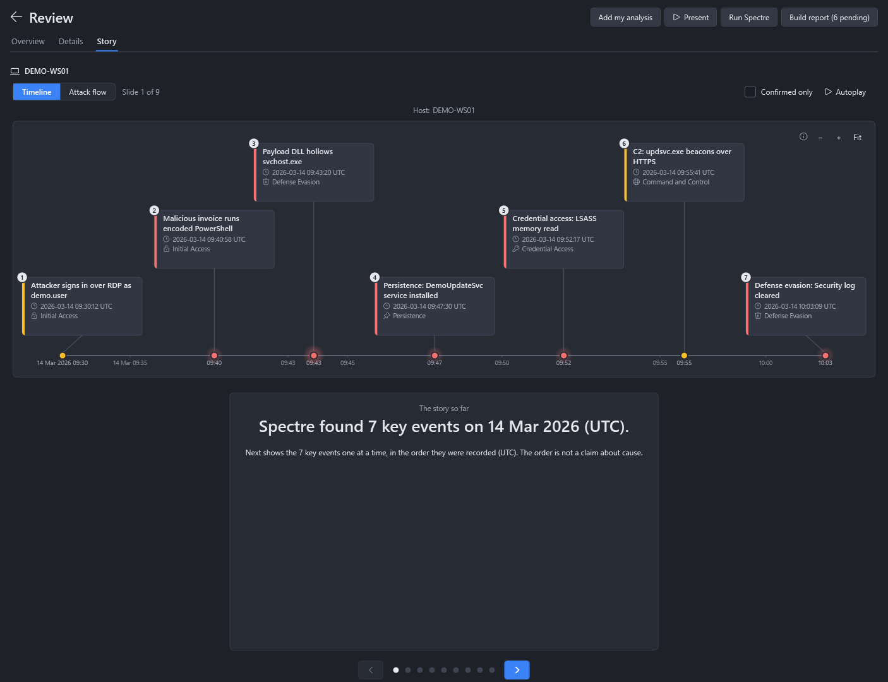

*Story view of the demo case analysed by Spectre: 7 key events on one timeline.*

**Try it without evidence:** click **Load demo case** on the Ingest or Review page. It opens a made-up attack on one PC, and the other screenshots below come from it. No internet or AI needed. The attack has eight steps:
1. RDP sign-in with a valid account (T1078).
2. Phishing document (T1566.001).
3. Encoded PowerShell (T1059.001).
4. Payload run through rundll32 (T1218.011).
5. Hollowed svchost (T1055.012).
6. New service for persistence (T1543.003).
7. LSASS memory read (T1003.001).
8. HTTPS beacon, then the Security log is cleared (T1070.001).

## Pages

- **Ingest**: point it at the evidence. It finds the artifacts and runs the right tools.
- **Analyze**: the results table, computer details and the process tree.
- **Explore**: look inside any file in the case without running it.
- **Review**: findings, key events, the story and the report.
- **AI**, **Tools** and **Options**: at the bottom of the left menu. AI holds Spectre's knowledge base.

## Features

### Set up

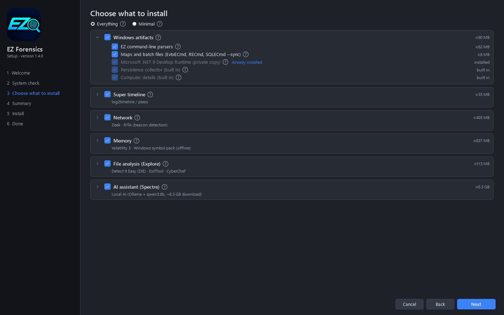

- One setup wizard installs everything:
  - Eric Zimmerman's tools and their maps.
  - plaso.
  - Volatility 3, with an optional offline Windows symbol pack.
  - Zeek and RITA.
  - Detect It Easy, ExifTool and CyberChef.
  - A local AI model (Ollama).
- Pick Minimal, Everything, or your own list. You see the download size first.
- Admin rights and one restart are needed only for Zeek and RITA.
- Tools are downloaded only from their official sites over HTTPS, and each download's SHA-256 is logged.

### Ingest

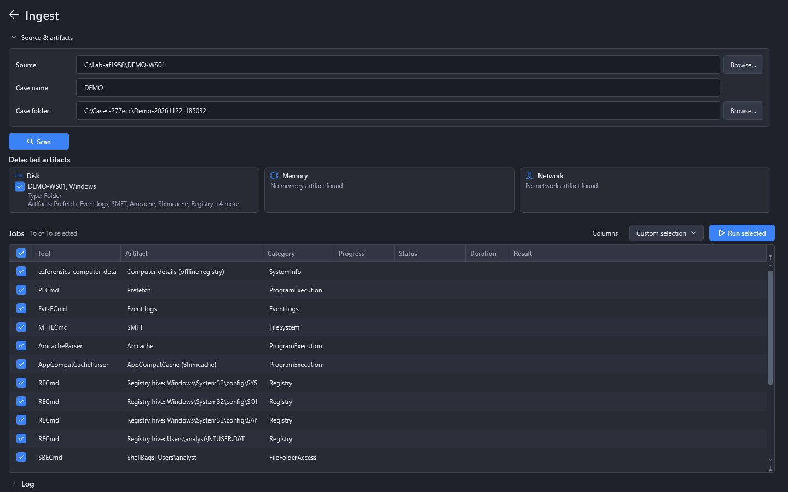

- **What it takes:**
  - KAPE collections, mounted images, folders, live drives, memory images and pcaps.
  - Archives: zip, 7z, rar, tar, gz, vhd and vhdx. It asks for the password if there is one.
- **What it finds:** each artifact gets its own job.
  - Event logs.
  - Registry hives: SYSTEM, SOFTWARE, SAM, NTUSER and UsrClass.
  - $MFT and $J.
  - Prefetch, LNK files and jump lists.
  - ShellBags, Amcache, ShimCache and SRUM.
  - Recycle Bin, browser data and other SQLite databases.
- **You stay in control:** untick jobs, or change the exact command line of any tool before it runs.
- **Jobs:** live logs, retry and cancel. Only a few heavy jobs run at once. A cancelled run picks up where it stopped.

### Analyze

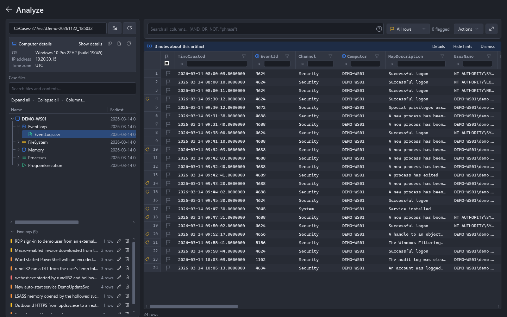

- **Fast with big files:** CSVs with millions of rows open quickly. Rows are read from disk as you scroll, so the whole file is never loaded into memory.
- **Sensible columns:** the time column comes first, and record IDs are hidden. You can still show them.
- **Search:**
  - Filter any column.
  - Search all columns with AND, OR, NOT and "exact phrases", or build a filter step by step.
  - Group, sort, merge CSVs, or open several files as one view.
- **Flags:** mark rows as Informational, Interesting, Suspicious, Malicious or Benign. Export the flagged or filtered rows. Save filters and views for the next case.
- **Computer details:** OS and build, IP addresses, time zone, disks and users, read from the registry.
- **Time warnings:** a banner tells you when timestamps may be wrong, for example on copied files.

#### Process tree

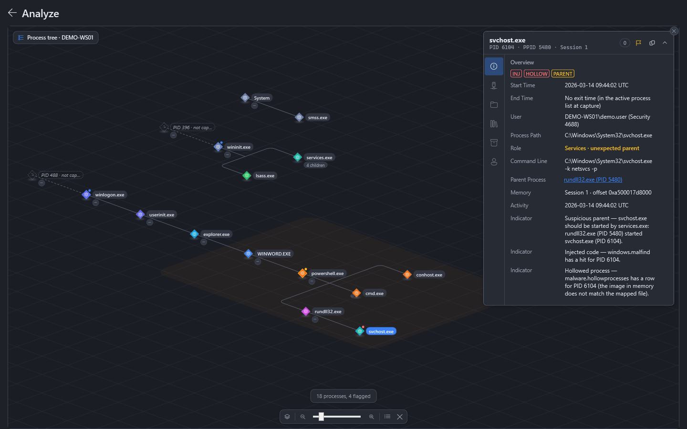

- **Built from:**
  - Memory: Volatility's pslist, psscan, cmdline, netscan, malfind and hollowprocesses.
  - Event logs: Security 4688 and Sysmon.
  - Each process also shows its Prefetch entries and Zeek connections.
- **What it flags:**
  - Hidden processes: found by psscan but missing from pslist.
  - Hollowed, ghosted and injected processes.
  - Wrong parents, for example svchost.exe not started by services.exe.
  - Encoded or obfuscated command lines.
- **Click a process** to see its network connections, files, registry keys, modules and scripts. Every flag shows the row it came from.

### Explore

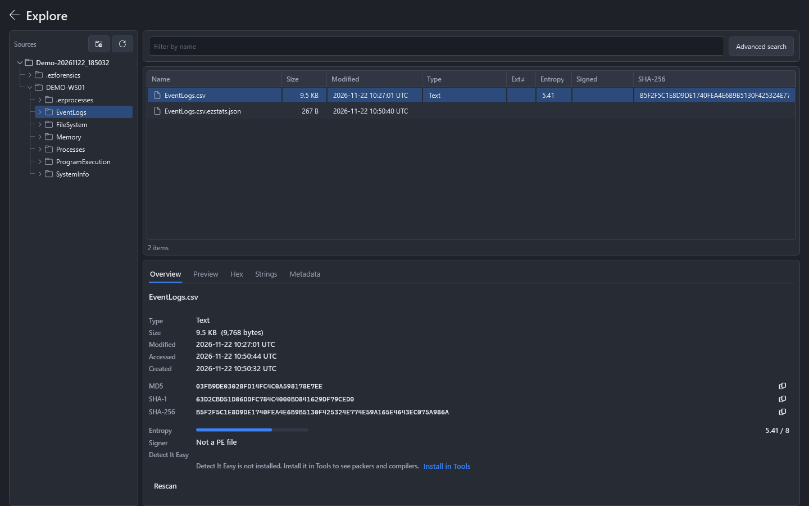

- **See inside a file:**
  - Hashes (MD5, SHA-1, SHA-256), entropy and signer.
  - File type (Detect It Easy) and metadata (ExifTool).
  - Hex, strings and PE headers.
- **Safe:** files are only read. They are never run or opened with their default app.
- CyberChef is built in and works offline.

### Review

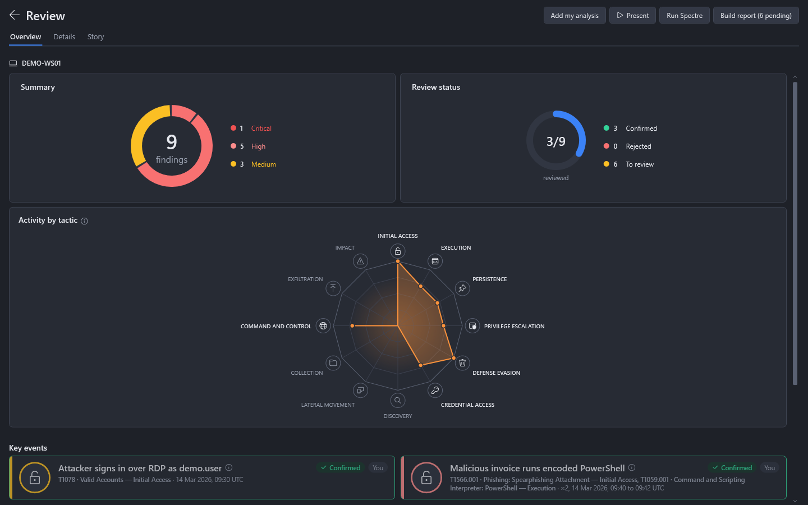

- **From row to story:** flag a row, make it a finding, then group findings into key events. Spectre's findings appear in the same list.
- **ATT&CK:** each finding has a technique ID. If a technique belongs to several tactics, the earliest one in the attack chain is shown.
- **Overview:** findings by severity, how many you have reviewed, and activity per tactic.

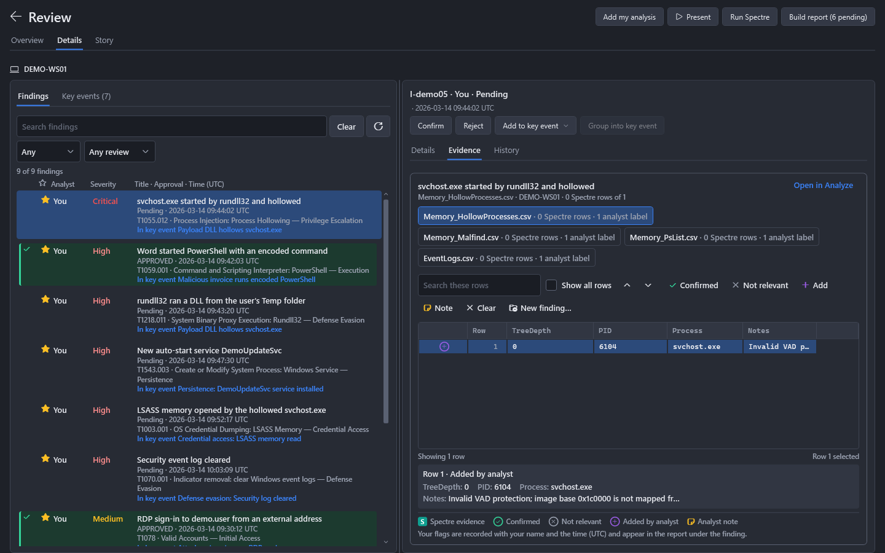

- **Confirm or reject** each finding next to the rows that support it. One click takes you back to those rows in the table.
- Every decision is saved with your name and the time (UTC), and shows in the report.

**Story** puts the key events on one timeline you can zoom (see the image at the top of this page). Long quiet gaps are shortened so the events stay readable.

**Attack flow** shows the same events in ATT&CK tactic columns, with arrows in the order they happened:

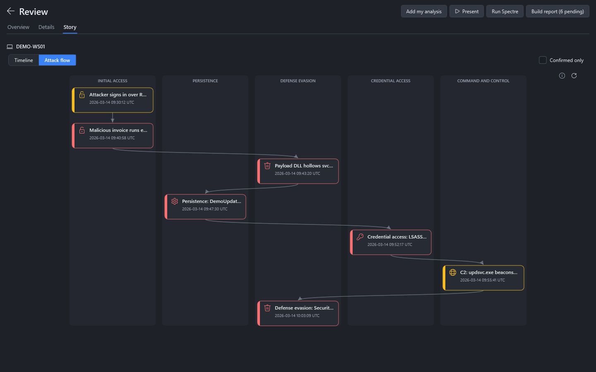

**Present** walks through the key events as slides, in plain language, for people who are not analysts:

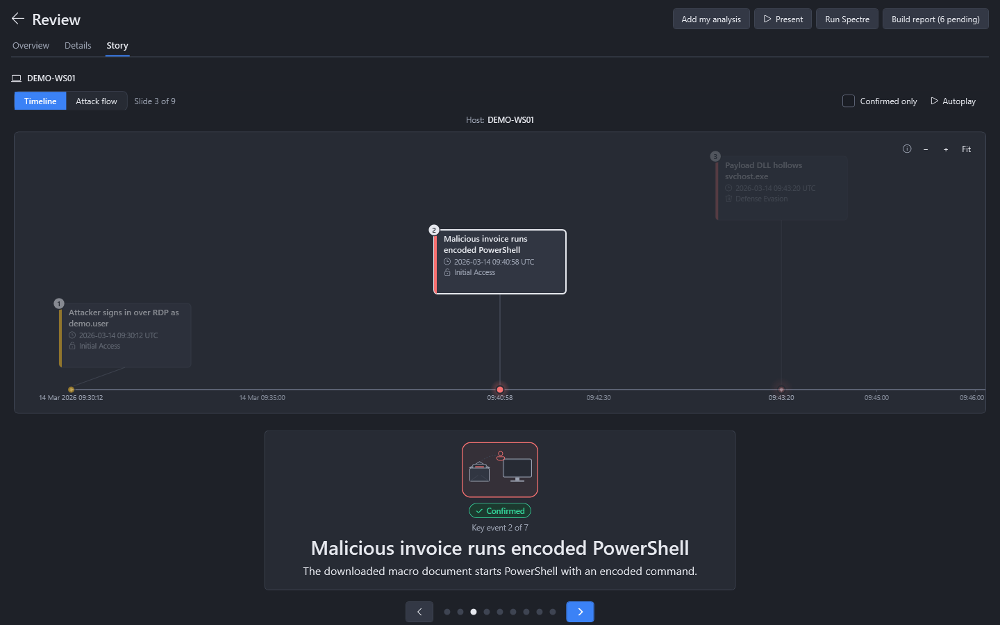

- **Report:** one HTML file that opens in any browser and prints well, or Markdown.

### Spectre (AI analyst)

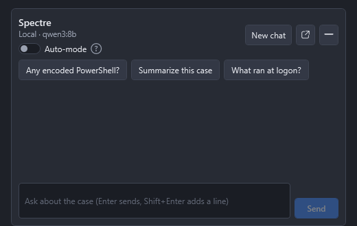

- **Analyses the case for you:**
  - Starts by itself after Ingest (Options › AI › Run Spectre after Ingest), or when you click **Run Spectre** on Review.
  - Reads every result, up to and including the super timeline, in several passes.
  - Drafts findings with a technique, a confidence level and the supporting rows, then builds the story timeline.
  - Running it again keeps your edits. Spectre never confirms its own findings; you do.
- **Works the app from chat:**
  - It has nearly 40 actions, picked for the page you are on. Examples: query a CSV, count values, filter, sort and flag the table, open a file, start Ingest, install a tool, search files, edit a finding, retry a job.
  - With Auto-mode on, it applies them directly. With it off, each one shows as a card you apply or dismiss. Applied changes can be undone.
- **Uses your own notes (RAG):**
  - Before it answers, it searches your knowledge base in two ways: by keyword (SQLite full-text search) and by meaning (a small embedding model, bge-small-en-v1.5, running on your CPU).
  - The two result lists are merged, and the best notes are added to the question.
  - The answer names the notes it used.
- **Your choice of model:** a local Ollama model by default. Anthropic, OpenAI and OpenRouter work with your own API key. Case data is sent to a cloud model only after you agree for that case.
- Set it up in **Options › AI**. See [docs/SETUP.md](docs/SETUP.md).

#### AI page: the knowledge base

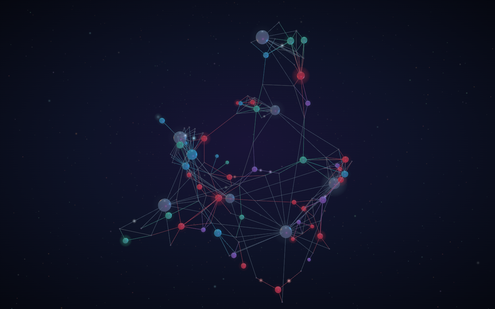

- **Add your material:** files, folders, Obsidian vaults (their links become links in the graph) and `.ezkb` packs (ready-made knowledge bases with their search index).
- **Prepared on your PC:**
  - Documents are split into chunks and indexed for search.
  - The AI adds a summary, category, type and tags to each document.
  - **Distill** breaks a long document into short notes, one idea each.
- **You decide what counts:** new documents wait on **To review**. Spectre uses only the ones you accept.
- **Graph** shows your accepted notes and how they link, in 3D. **Library** lists where they came from. Everything stays on your PC.

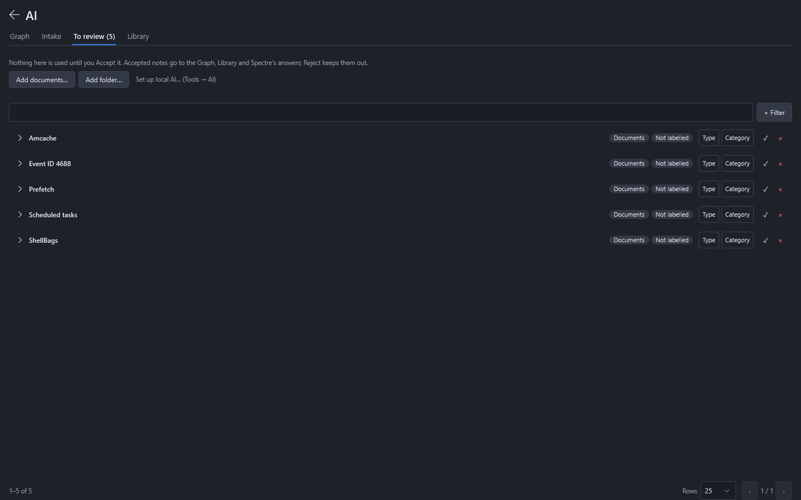

### Tools

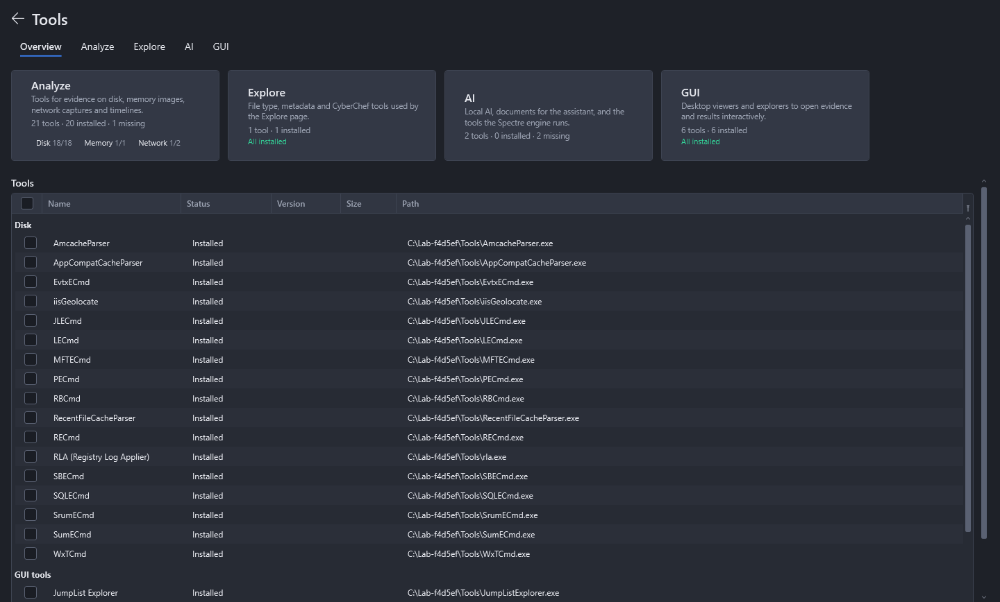

- See every tool with its status, version and path. Install, update or remove it.
- Change tool settings, for example which EvtxECmd maps and event IDs to use, or the command line Ingest runs for each artifact.

### Also included

- **Persistence:** Run keys, services, scheduled tasks, WMI and startup folders, read offline from the evidence.
- **Timelines:** a super timeline (plaso) and a file-system timeline from $MFT.
- **Memory:** Volatility 3, with a list of plugins you can pick from.
- **Network:** Zeek turns pcaps into connection, DNS, HTTP and TLS logs. RITA finds beaconing, long connections and DNS tunnelling.

## Requirements

- Windows 10 (1809 or later) or Windows 11, 64-bit.
- About 1 GB of free disk for the Minimal set. Everything needs more, and cases need their own space.
- Internet during setup.

## Install

1. Download `EzForensics-Setup.exe` from [Releases](https://github.com/jlab1201/EZforensics/releases).
2. Run it. No admin rights needed.
3. Follow the setup wizard on first start. It may ask for admin rights once and a restart if you pick Zeek or RITA.

The installer is not code-signed, so Windows SmartScreen may warn. Click **More info**, then **Run anyway**. To check the download first, compare the SHA-256 shown on the release page with the output of:

```powershell
Get-FileHash .\EzForensics-Setup.exe -Algorithm SHA256
```

More in [docs/SETUP.md](docs/SETUP.md).

## Build from source

- Install the .NET 8 SDK.
- Build: `dotnet build EzForensics.sln`
- Test: `dotnet test tests/EzForensics.Core.Tests` and `dotnet test tests/EzForensics.App.Tests`
- Run: `dotnet run --project src/EzForensics.App`
- Optional: `build/get-embedding-model.ps1` downloads the model for the AI page's meaning-based search. Without it, the page uses keyword search only.
- Installer: `build/make-installer.ps1`

See [CONTRIBUTING.md](CONTRIBUTING.md) to contribute, including how to regenerate these screenshots.

## License

MIT, see [LICENSE](LICENSE). Third-party software is listed in [THIRD-PARTY-NOTICES.md](THIRD-PARTY-NOTICES.md). The tools are downloaded from their official sources, not bundled (except the items listed in THIRD-PARTY-NOTICES.md).

## Disclaimer

Use it only on evidence you are authorised to examine. No warranty. Verify important findings with a second tool.

Report security issues as described in [SECURITY.md](SECURITY.md).
